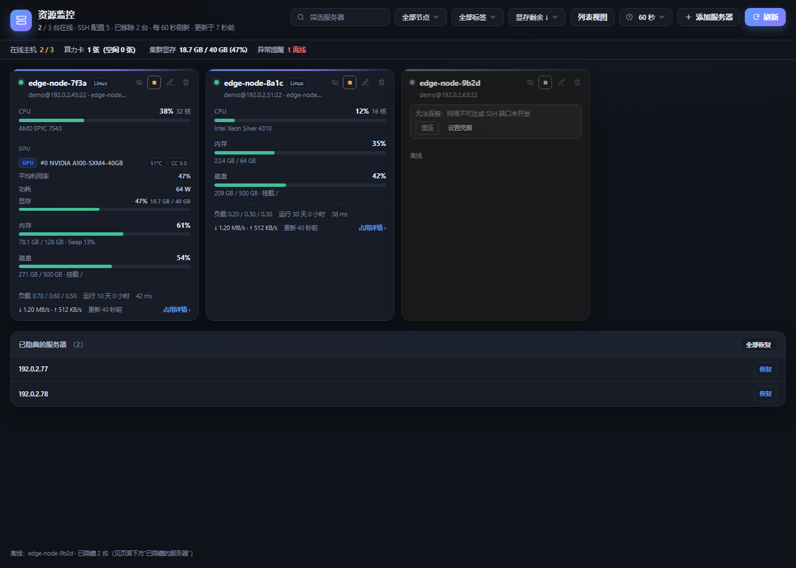
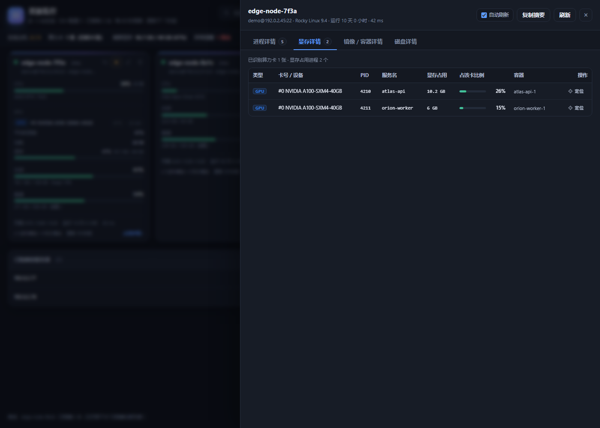

# dsh-server-monitor

[English](README.md) | [简体中文](README.zh-CN.md)

在 DeepSeek Harness 中查看本机与 SSH 服务器资源，提供全局面板和会话页签两种入口。



## 功能

- **基础资源**：CPU、内存、Swap、磁盘、网络、负载、运行时间、SSH 延迟。
- **异构算力**：NVIDIA GPU / 华为昇腾 NPU / 海光 DCU 的利用率、显存、温度、功耗。
- **进程**：可搜索、排序的进程表；确认后发送 `SIGTERM`，失败可再确认发送 `SIGKILL`。
- **Docker**：镜像和容器列表、启停/重启/删除、带逐项进度的批量删除、启动参数、镜像依赖树。
- **连不上也看得见**：登录失败的服务器以灰度卡片保留，可直接重连，或就地填写密码 / 私钥修复。
- **隐藏与恢复**：卡片右上角的眼睛按钮可隐藏服务器，隐藏列表显示在面板下方，重启后依然保留。
- **两种入口**：全局服务器面板；跟随当前会话工作区的服务器页签。
- **只读采集**：资源采样只执行只读命令，凭据保存在本地。

## 安装

### npm

```bash
dsh plugin --profile desktop add dsh-server-monitor
```

### GitHub

在 **设置 → 插件 → 安装** 中填入：

```text
https://github.com/xua123/dsh-server-monitor
```

安装后完全退出 DSH（托盘 Quit）再启动。

### GitHub Release 压缩包

```text
https://github.com/xua123/dsh-server-monitor/releases/download/v0.2.1/dsh-server-monitor-0.2.1.tgz
```

链接固定在 `v0.2.1`，资源文件名里的版本号可以安全保留。

环境要求：DSH `>= 0.2.1-rc.1`，Node `>= 20`。

## 使用

### 全局面板

点击左侧栏服务器图标打开面板，列表包含：

- 本机；
- 从 `~/.ssh/config` 发现的主机；
- 面板中手动添加的服务器。

支持搜索、标签筛选、卡片/列表视图，以及按显存余量、CPU、内存或平均利用率排序。

### 会话页签

在会话中打开「资源监控」页签：页签读取会话工作区，只展示匹配的那台服务器；匹配不到时可在页签头部选择。

### 连不上的服务器

连接失败的主机以灰度卡片显示，而不是直接消失：

- **重连**：断开该主机在连接池里的旧连接并立即重新采集。
- **设置凭据 / 编辑凭据**：弹窗预填地址、端口、用户名，可填写密码或私钥（粘贴私钥、选择私钥文件、私钥路径，支持口令），**地址和端口也可以修改**。
- 对来自 `~/.ssh/config` 的主机，保存后会写入一份手动凭据，覆盖该地址的配置项；以后在「已添加的服务器」里删除这条即可回到 `~/.ssh/config` 的配置。
- 保存成功会关闭弹窗、闪一下对应卡片并在顶部显示几秒的绿色提示；连接失败则保留弹窗和真实 SSH 错误，方便继续改凭据。

如果更希望认证失败的主机折叠成页脚一行提示，可在插件配置里设置 `hideAuthFailures: true`。

### 隐藏与恢复

点击卡片右上角的眼睛按钮即可隐藏该服务器。隐藏的主机会列在面板下方的「已隐藏的服务器」区块：

- **恢复**：恢复单台；
- **全部恢复**：恢复全部。

隐藏记录保存在 `~/.dsh/server-monitor/hidden.json`，刷新页面、插件热更新、DSH 重启都不会丢失。

## 资源覆盖

| 类别 | 数据 |
| --- | --- |
| CPU | 使用率、核心数、型号、1/5/15 分钟负载 |
| 内存 | 已用/总量、百分比、Swap |
| 磁盘 | 根目录与各挂载点、已用/总量、最忙挂载点 |
| 网络 | 收发速率 |
| 系统 | 主机名、系统版本、内核、运行时间、SSH 延迟 |
| GPU | 利用率、显存、温度、功耗、计算能力 |
| NPU | AICore 利用率、显存、温度、功耗；兼容昇腾 310P/910B |
| DCU | 利用率、显存、温度、功耗；兼容 `hy-smi` JSON/表格输出 |
| 容器 | 运行在容器内时的 CPU/内存限额 |

### 进程详情


### 显存详情



## 进程与 Docker 操作

进程终止和 Docker 变更需要页面令牌，并会先弹出确认框。

- 只有当 PID 出现在当前详情视图里时才能终止该进程。
- 先发送 `SIGTERM`；若进程仍在，会单独提供「强制杀死（SIGKILL）」。
- 容器的启动、停止、重启、删除均需确认。
- 删除镜像失败时会列出仍在引用它的容器。
- 运行中的容器需先停止才能删除。
- 多选删除会先列出全部目标，再逐条执行，并显示每一项的状态与失败原因（含占用镜像的容器）。

### 容器详情


## 0.2.1 更新

- SSH 认证失败不再导致 DSH 宿主进程崩溃；不再向传输层提供无人监听的 SSH agent。
- 连接失败的主机以灰度卡片保留，支持重连与凭据编辑（含 ssh-config 主机，地址与端口可改）。
- 新增眼睛按钮隐藏服务器，并在面板下方提供持久化的隐藏列表。
- 批量删除镜像/容器会列出目标清单并逐项显示进度。
- 移除了「显示范围」（全部显示 / 仅显示选中）筛选，改为按需隐藏单台主机。

## 安全

- 资源采集只使用 `/proc`、`df`、`nvidia-smi`、`npu-smi`、`hy-smi` 等只读命令；
- 不上传遥测或资源数据；
- 手动添加的密码仅保存在本机 `~/.dsh/server-monitor/targets.json`（`0600`），建议优先使用 SSH 密钥；
- 隐藏列表、别名、置顶/标签/暂停等主机偏好保存在本机 `~/.dsh/server-monitor/` 下；
- 仓库中不包含服务器地址、凭据、私有主机名或客户数据。

## 限制

- 远程采集面向 Linux，Windows 仅支持本机；
- 暂不支持 `ProxyJump` / `ProxyCommand`；
- NPU/DCU 功耗上限取决于厂商工具，无上限时只显示实际功耗；
- 会话绑定依赖 DSH 会话的 `cwd` 元数据，无法解析时请用手动选择器。

## 开发

```bash
npm install
npm test
npm pack
```

## License

MIT
