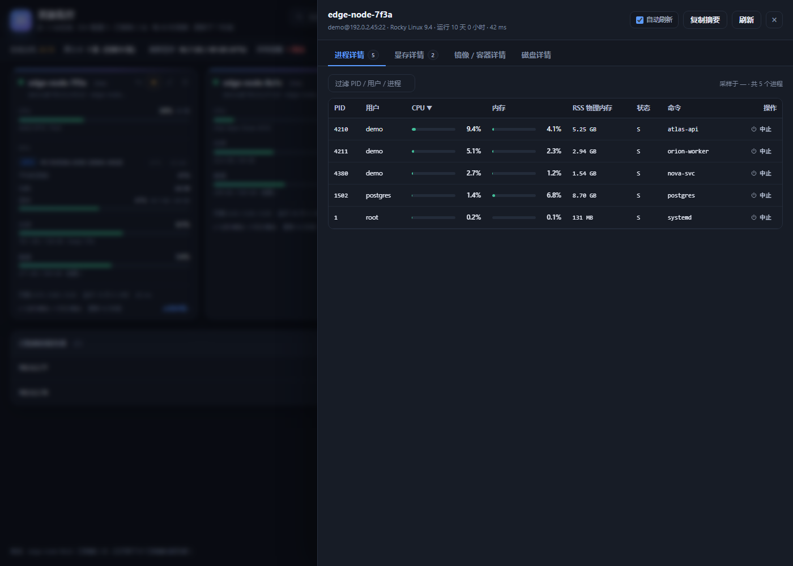
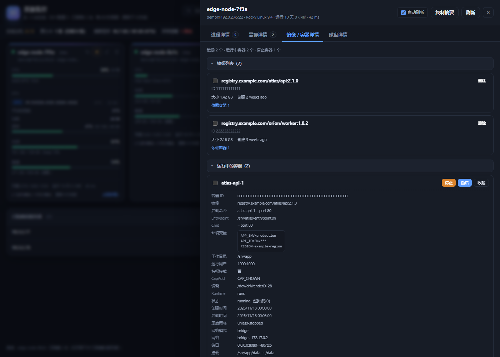

# dsh-server-monitor

[English](README.md) | [简体中文](README.zh-CN.md)

在 DeepSeek Harness 中查看本机与 SSH 服务器资源，提供全局面板和会话页签两种入口，并支持进程、Docker、镜像和服务器管理操作。


## 功能

- **主机资源**：CPU、内存、Swap、磁盘挂载、网络吞吐、负载、运行时间和 SSH 延迟。
- **异构算力**：NVIDIA GPU、华为昇腾 NPU、海光 DCU 的逐卡利用率、显存、温度和功耗。
- **进程**：可搜索、排序的进程表；确认后发送 `SIGTERM`，失败可再确认发送 `SIGKILL`。
- **已删除服务器**：主面板下方展开，可恢复服务器，或彻底删除 SSH 配置中的 Host 块。
- **Docker**：镜像和容器列表、启停/重启/删除、多选批量删除与进度、启动参数和镜像依赖树。
- **服务器管理**：隐藏或恢复服务器，彻底删除 SSH 配置中的 Host 块；新增服务器自动同步写入 `~/.ssh/config`。
- **两种入口**：全局服务器面板，以及跟随当前会话工作区的服务器页签。
- **只读采集**：资源采样只执行只读命令，凭据保存在本地。

## 安装

### npm

```bash
dsh plugin --profile desktop add dsh-server-monitor
```

### GitHub

1. 打开 **设置 → 插件 → 安装**。
2. 填入：

```text
https://github.com/xua123/dsh-server-monitor
```

3. 完全退出 DSH，再重新启动。

### GitHub Release tarball

```text
https://github.com/xua123/dsh-server-monitor/releases/download/v0.2.8/dsh-server-monitor-0.2.8.tgz
```

链接固定到 `v0.2.8`，因此文件名可以安全地包含版本号。

要求：DSH `>= 0.2.1-rc.1`，Node `>= 20`。

## 使用

### 全局面板

点击左侧栏的服务器图标。面板会列出：

- 本机；
- 从 `~/.ssh/config` 发现的主机；
- 在面板中手动添加的主机。

支持搜索、标签过滤、卡片/列表视图，以及按剩余显存、CPU、内存或平均利用率排序。

### 会话页签

在会话中打开「资源监控」页签。页签读取当前会话工作区，只显示匹配的服务器；匹配不到时，可在页签顶部手动选择。

## 操作

- **进程**：发送 `SIGTERM` 中止进程；如果进程仍在，再提供确认后的 `SIGKILL` 强制杀死。
- **容器**：启动、停止、重启、删除；勾选多个容器后，点击卡片旁的「删除」打开批量确认，进度按实际成功数显示 `1/3`、`2/3`、`3/3`。
- **镜像**：删除镜像；删除被阻止时列出仍在使用它的容器；查看镜像到容器的依赖树。
- **服务器**：从监控列表隐藏或恢复服务器；二次确认后从 SSH 配置彻底删除对应 Host 块。新增服务器会追加到 SSH 配置，并在修改前备份。

## 资源覆盖

| 类别 | 数据 |
| --- | --- |
| CPU | 使用率、核心数、型号、1/5/15 分钟负载 |
| 内存 | 已用 / 总量、占用率、Swap |
| 磁盘 | 根分区及各挂载点容量、已用 / 总量、最忙挂载点 |
| 网络 | 实时收 / 发速率 |
| 系统 | 主机名、系统版本、内核、运行时间、SSH 延迟 |
| GPU | 利用率、显存、温度、功耗、Compute Capability |
| NPU | AICore 利用率、显存、温度、功耗；兼容昇腾 310P / 910B |
| DCU | 利用率、VRAM、温度、功耗；兼容 `hy-smi` JSON / 表格 |
| 容器 | 在容器内运行时显示 CPU / 内存限制 |

### 进程详情



### 显存详情


## 进程与 Docker 操作

进程终止和 Docker 修改操作需要页面 token，并会弹出确认框。

- 只有当前详情列表中存在的 PID 才能终止；
- 先发送 `SIGTERM`，进程仍在时再提供「强制杀死（SIGKILL）」；
- 容器启动、停止、重启和删除都需要确认；
- 删除镜像失败时，会列出仍在使用该镜像的容器；
- 运行中的容器必须先停止才能删除。

### 容器详情



## 安全与隐私

- 资源采集使用只读命令，例如 `/proc`、`df`、`nvidia-smi`、`npu-smi`、`hy-smi`；
- 插件不上传遥测或资源数据；
- 手动添加的密码保存在本机 `~/.dsh/server-monitor/targets.json`，权限 `0600`，建议优先使用 SSH 密钥；
- 主机隐藏、别名和选择状态保存在本机 `~/.dsh/server-monitor/`；
- 仓库中不包含服务器地址、凭据、私有主机名或客户数据。

## 限制

- 远程采集面向 Linux；Windows 仅支持本机；
- 暂不支持 `ProxyJump` / `ProxyCommand`；
- 不需要 DCGM exporter 或 Prometheus；
- NPU/DCU 的功耗上限取决于厂商工具，没有上限时只显示实际功耗；
- 会话自动绑定依赖 DSH 会话的 `cwd` 元数据，无法识别时请手动选择服务器。

## 开发

```bash
npm install
npm test
npm pack
```

## License

MIT
